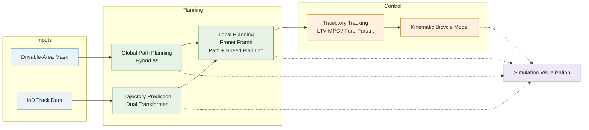

# Prediction-Planning-Control

**An Integrated Autonomous Driving Pipeline for Trajectory Prediction, Motion Planning, and Vehicle Control**

A Python-based autonomous driving project using the [inD dataset](https://www.ind-dataset.com/). The system integrates transformer-based vehicle trajectory prediction, Hybrid A* global path planning, Frenet-frame local planning, and vehicle control in a unified simulation environment.

## Overview

Autonomous driving requires more than an individual prediction or planning algorithm. Predicted movements of surrounding vehicles must be considered during local planning, and the resulting trajectory must be tracked by a vehicle controller.

This project brings these components together in a modular pipeline:

- **Trajectory Prediction** — Dual Transformer-based prediction of surrounding vehicles' future trajectories.
- **Global Path Planning** — Hybrid A* search for a feasible global path.
- **Local Planning** — Frenet-frame trajectory generation with path and speed planning, incorporating predicted vehicle trajectories.
- **Vehicle Control** — LTV-MPC and Pure Pursuit controllers for trajectory tracking.
- **Simulation and Visualization** — Animated visualization of vehicle motion and the integrated planning pipeline.

## System Architecture

The system connects global route generation, future-motion prediction, local trajectory planning, and vehicle control. The global path provides spatial guidance, while predicted vehicle trajectories provide information about surrounding traffic for local planning.



### Planning and Control Pipeline

| Component | Algorithm | Role |
|---|---|---|
| Global planning | Hybrid A* | Generates a global path from the start to the goal |
| Trajectory prediction | Dual Transformer | Predicts future trajectories of surrounding vehicles |
| Local planning | Frenet-frame trajectory generation | Plans a local path and speed profile using the global path and predicted traffic |
| Vehicle control | LTV-MPC / Pure Pursuit | Tracks the planned trajectory |
| Vehicle model | Kinematic Bicycle Model | Represents vehicle motion for simulation and control |

## Methods

### 1. Trajectory Prediction

The Dual Transformer model predicts future vehicle trajectories from observed inD traffic data.

The prediction module supplies future-motion information to the local planner, allowing planning decisions to account for the anticipated movements of surrounding vehicles rather than relying solely on their current positions.

### 2. Global Path Planning

Hybrid A* generates a global path between a specified ego-vehicle start state and goal.

A drivable-area mask and collision checking are used in the global planning process. The resulting path provides the spatial reference for subsequent local planning.

### 3. Frenet-Frame Local Planning

The local planner operates in the Frenet coordinate system relative to the global reference path.

It generates candidate local trajectories and plans both the path and speed profile. Predicted trajectories from the Dual Transformer are incorporated into the planning process to account for surrounding traffic.

The selected local trajectory provides the reference for vehicle control.

### 4. Vehicle Control

The project includes two trajectory-tracking approaches:

- **LTV-MPC:** Uses a vehicle model and a finite prediction horizon to optimize control actions for trajectory tracking.
- **Pure Pursuit:** Computes steering commands from a target point on the reference path.

The Kinematic Bicycle Model represents vehicle motion in the simulation.

## Getting Started

### Requirements

The project uses Python and the dependencies listed in `requirements.txt`. The original environment specifies PyTorch 1.13.1 (CPU), NumPy, Pandas, OpenCV, Matplotlib, and tqdm.

### Installation

```bash
git clone https://github.com/jeongseonarm/prediction-planning-control.git
cd prediction-planning-control
pip install -r requirements.txt
```

Use a compatible Python environment and install the dependencies specified by the repository.

## Data and Model Setup

The following resources are required to run the integrated pipeline.

| Resource | Expected location | Contents |
|---|---|---|
| Traffic data | `trajectory_prediction/Data/` | inD track CSV files and scene background images |
| Drivable-area masks | `map/drivable_mask_images/` | Mask images used for global path planning |
| Prediction model files | `trajectory_prediction/log/` | Model configuration files (`.json`) and trained weights (`.pt`) |

The inD dataset and trained prediction-model weights are not included in the repository and must be obtained separately.

Ensure that the configured data paths, model files, and scene settings match the selected simulation.

## Running the Simulation

From the repository root, run:

```bash
python main.py
```

The simulation entry point coordinates the configured prediction, planning, control, and visualization workflow.

### Main Configuration Parameters

The following parameters in `main.py` configure the simulation:

| Parameter | Purpose |
|---|---|
| `DATA_NUM` | Selects the dataset or scene |
| `EGO_START` | Defines the ego-vehicle start state |
| `EGO_GOAL` | Defines the global planning goal |
| `TARGET_SPEED` | Sets the configured target speed |
| `MPC_HORIZON` | Sets the LTV-MPC prediction horizon |
| `INPUT_FRAME` | Sets the number of observed frames for prediction |
| `OUTPUT_FRAME` | Sets the number of future frames predicted |
| `PREDICTION_START_FRAME` | Sets the start frame for the simulation interval |
| `PREDICTION_END_FRAME` | Sets the end frame for the simulation interval |

Parameter availability and behavior depend on the implementation in `main.py`.

## Repository Structure

```text
prediction-planning-control/
├── trajectory_prediction/
│   ├── Data/
│   ├── log/
│   ├── Models/
│   │   └── Dual_transformer.py
│   └── Utils/
│       ├── Average_deviation.py
│       ├── Base.py
│       ├── Draw_trajectory.py
│       ├── Draw_vehicle.py
│       └── Make_tensor.py
├── planning/
│   ├── global_path_planning/
│   │   ├── hybrid_a_star.py
│   │   └── collision_checker.py
│   └── local_planning/
├── control/
│   ├── controllers/
│   │   ├── ltv_mpc.py
│   │   └── pure_pursuit.py
│   └── models/
│       └── kinematic_bicycle.py
├── map/
│   └── drivable_mask_images/
├── main.py
├── requirements.txt
└── .gitignore
```

## Results

### Integrated Simulation

Add an animation or screenshot of the integrated simulation here to demonstrate the relationship between predicted trajectories, the planned local trajectory, and ego-vehicle motion.

<!-- Replace this section with a committed simulation GIF or image when available. -->

### Trajectory Prediction

Quantitative trajectory prediction results, such as Average Displacement Error (ADE) and Final Displacement Error (FDE), can be reported here when evaluated results are available.

### Planning and Control

Simulation results can be used to illustrate global path generation, Frenet-frame local planning, and trajectory tracking with LTV-MPC or Pure Pursuit.

## References

- [inD Dataset](https://www.ind-dataset.com/)
- [MotionPlanning — zhm-real](https://github.com/zhm-real/MotionPlanning)
- [Motion Planning for Autonomous Driving with MPC](https://github.com/TGoldC/Motion-Planning-for-Autonomous-Driving-with-MPC/)

## License

Refer to the repository's license information before redistributing or reusing this project.
