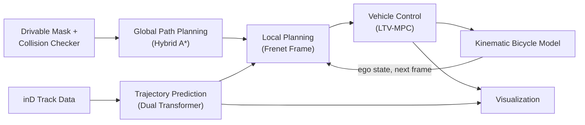

# Prediction-Planning-Control

Python implementation of an autonomous driving pipeline on the **inD dataset**: trajectory prediction, global path planning, Frenet-frame local planning, and vehicle control, integrated into a single closed-loop simulation with animated visualization.

---

## What is this?

This repository combines four components of a self-driving stack into one runnable simulation:

- **Trajectory prediction** of surrounding vehicles (Dual Transformer)
- **Global path planning** for the ego vehicle (Hybrid A*)
- **Local planning** in the Frenet frame, with collision checks against the predicted vehicles
- **Vehicle control** using LTV-MPC (OSQP) on a kinematic bicycle model

Every frame the ego vehicle predicts the traffic around it, plans a short collision-free trajectory, and tracks it with the MPC. The ego state is then advanced with the vehicle model and the loop repeats.

---

## Pipeline



| Stage | Method | Code |
|---|---|---|
| Global path planning | Hybrid A* over a drivable-area mask | `planning/global_path_planning/` |
| Trajectory prediction | Dual Transformer, 25 frames in, 75 frames out (0.04 s steps); constant-velocity fallback for short histories | `trajectory_prediction/` |
| Local planning | Frenet-frame candidates (Werling et al., 2010): quartic s(t) x quintic d(s), cost-ordered, footprint collision check against predicted vehicles, fallbacks. The target speed is a planner parameter and is lowered near the end of the path | `planning/local_path_planning/` |
| Control | LTV-MPC, one OSQP QP per step | `control/` |
| Visualization | matplotlib animation | `simulation/visualization.py` |

---

## Getting Started

### Requirements

```bash
git clone https://github.com/jeongseonarm/prediction-planning-control.git
cd prediction-planning-control
pip install -r requirements.txt
```

Key dependencies: PyTorch (CPU is enough), NumPy, SciPy, Pandas, OpenCV, matplotlib, OSQP, tqdm.

### Data Preparation

| Path | Contents |
|---|---|
| `trajectory_prediction/Data/18_tracks_del_vru_static_maneuver.csv` | inD track CSV (recording 18, vehicles only) |
| `trajectory_prediction/Data/inD_backgroud_images/18_background.png` | scene background image |
| `map/drivable_mask_images/18_mask.png` | drivable-area mask for the scene (included) |
| `trajectory_prediction/log/` | prediction model config (`.json`, included) |
| `trajectory_prediction/log/pt/*.pt` | trained weights (the newest file is loaded) |

Pretrained weights and the inD dataset are **not included** in this repo and must be obtained separately (see `NOTICE.md`).
The drivable-area mask was drawn by hand with `map/extract_driving_area.py`; the lane side the ego may use is limited by `lateral_offsets` in `config.py`, not by the mask.

### Run

```bash
python main.py                      # simulate and show the animation
python main.py --no-viz             # headless
python main.py --save result.gif    # write the animation instead of showing it (real-time speed, plays once)
python main.py --controller nmpc    # SLSQP reference controller instead of LTV-MPC
python main.py --save result.gif --fps 12   # slower playback
python main.py --save result.gif --loop     # GIF repeats forever (default: plays once)
python main.py --start-frame 300 --end-frame 400
```

### Key Parameters (`config.py`, class `ScenarioConfig`)

| Parameter | Description |
|---|---|
| `data_num` | inD scene/recording number to load |
| `ego_start`, `ego_goal` | ego vehicle start/goal pose `(x, y, yaw)` |
| `initial_speed`, `target_speed_kmh`, `max_speed_kmh` | initial, cruising and maximum speed |
| `max_accel`, `safety_margin` | planner acceleration limit, clearance between vehicle footprints |
| `lateral_offsets` | lateral offsets sampled by the local planner (d < 0: own lane, d > 0: oncoming lane) |
| `controller`, `mpc_horizon`, `dt` | `"ltv"` or `"nmpc"`, MPC horizon in steps, control step in seconds |
| `input_frame`, `output_frame` | input/output frame length for trajectory prediction |
| `start_frame`, `end_frame` | frame range simulated |

---

## Project Structure

```text
prediction-planning-control/
├── main.py                          # command line entry point
├── config.py                        # every scenario parameter
├── simulation/
│   ├── world.py                     # mask, collision checker, global path
│   ├── runner.py                    # closed loop: predict -> plan -> control -> step
│   └── visualization.py             # animation
├── trajectory_prediction/
│   ├── predictor.py                 # per-frame prediction interface
│   ├── Data/                        # inD track CSVs, background images (not in repo)
│   ├── log/                         # training configs (json); weights (.pt) not in repo
│   ├── Models/
│   │   └── Dual_transformer.py      # trajectory prediction model
│   └── Utils/
│       ├── Average_deviation.py
│       ├── Base.py                  # config loading, scale un-normalization
│       ├── Draw_trajectory.py
│       ├── Draw_vehicle.py
│       └── Make_tensor.py
├── planning/
│   ├── global_path_planning/
│   │   ├── hybrid_a_star.py         # Hybrid A* global planner
│   │   └── collision_checker.py     # mask-based collision checking
│   └── local_path_planning/
│       ├── frenet_local_planner.py          # planner entry point
│       ├── frenet_trajectory_generator.py   # candidate generation
│       ├── frenet_vectorized.py             # Frenet -> Cartesian, batched
│       ├── cartesian_frenet_converter.py    # from PythonRobotics, unchanged
│       └── smoothing_reference_path.py      # waypoints -> smooth reference line
├── control/
│   ├── controllers/
│   │   ├── ltv_mpc.py               # Linear Time-Varying MPC (OSQP)
│   │   └── nmpc_slsqp.py            # nonlinear MPC (SLSQP), reference only
│   └── models/
│       └── kinematic_bicycle.py     # vehicle kinematics model
├── map/
│   ├── drivable_mask_images/        # drivable-area mask images
│   └── extract_driving_area.py      # mask drawing tool
├── requirements.txt
├── LICENSE
├── NOTICE.md
└── .gitignore
```

---

## Local Planner

```python
from planning.local_path_planning.frenet_local_planner import (
    FrenetLocalPlanner, PlannerConfig, resample_reference)

planner = FrenetLocalPlanner(PlannerConfig(), is_collision_fn=checker.check,
                             is_collision_many_fn=checker.check_many)
planner.set_waypoints(global_path)                    # (N, >=2) x, y[, yaw]
traj = planner.plan(ego_state,                        # [x, y, yaw, v, a, steer]
                    predictions,                      # list of (K, 2) paths, 0.04 s apart
                    obstacle_sizes, obstacle_headings)
reference = resample_reference(traj, 0.04, 11)        # rows x, y, yaw, v for the MPC
```

`traj` is always a dict (`t, x, y, yaw, kappa, v, a, steer, cost, target_d, target_speed, duration, status, collision_risk`). `status` tells how it was made:

| status | meaning |
|---|---|
| `ok` | cheapest candidate that passes the kinematic, collision and map checks |
| `min_risk` | every candidate collides; the least risky one is used because it beats braking |
| `reused` | no valid candidate because of kinematics or the map; the previous trajectory is kept (up to 3 cycles) |
| `stop` | constant-deceleration braking along the reference |

`planner.last_info` holds the reason and how many candidates each check rejected.

---

## Results

### Quantitative

<!--
| Metric | Value |
|---|---|
| Average Deviation (ADE) | TBD |
-->

### Qualitative

<!--

-->

---

## License

MIT, see [`LICENSE`](LICENSE). The Frenet-frame code is based on [PythonRobotics](https://github.com/AtsushiSakai/PythonRobotics) (MIT) and Werling et al., *Optimal Trajectory Generation for Dynamic Street Scenarios in a Frenet Frame* (2010); see [`NOTICE.md`](NOTICE.md). The inD dataset has its own terms and is not part of this repository.
