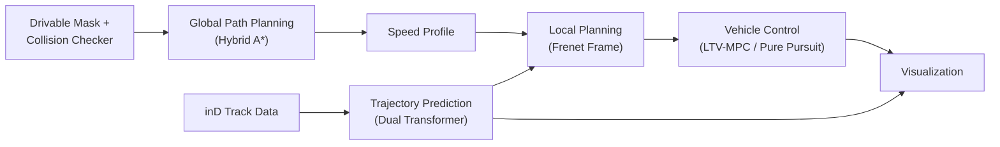

# Prediction-Planning-Control

Python implementation of an autonomous driving pipeline on the **inD dataset**: trajectory prediction, global path planning, Frenet-frame local planning, and vehicle control, integrated into a single simulation with animated visualization.

---

## What is this?

This repository combines four components of a self-driving stack into one runnable simulation:

- **Trajectory prediction** of surrounding vehicles (Dual Transformer)
- **Global path planning** for the ego vehicle (Hybrid A*)
- **Local planning** in the Frenet frame
- **Vehicle control** using LTV-MPC / Pure Pursuit

---

## Pipeline



| Stage | Method |
|---|---|
| Global path planning | Hybrid A* over a drivable-area mask |
| Speed profile | Target-speed profile along the planned path |
| Local planning | Frenet-frame trajectory generation with predicted-obstacle avoidance |
| Control | LTV-MPC (default), Pure Pursuit as an alternative |
| Trajectory prediction | Dual Transformer, evaluated against ground truth |
| Visualization | matplotlib animation |

---

## Getting Started

### Requirements

```bash
git clone https://github.com/jeongseonarm/prediction-planning-control.git
cd prediction-planning-control
pip install -r requirements.txt
```

Key dependencies: PyTorch 1.13.1 (CPU), NumPy, Pandas, OpenCV, matplotlib, tqdm.

### Data Preparation

Required data (see path constants at the top of `main.py`):

| Path | Contents |
|---|---|
| `trajectory_prediction/Data/` | inD track CSV + scene background image |
| `map/drivable_mask_images/` | drivable-area mask image for the scene |
| `trajectory_prediction/log/` | prediction model config (`.json`) and trained weights (`.pt`) |

Pretrained weights and the inD dataset are **not included** in this repo and must be obtained separately.

### Run

```bash
python main.py
```

### Key Parameters (`main.py`)

| Parameter | Description |
|---|---|
| `DATA_NUM` | inD scene/recording number to load |
| `EGO_START`, `EGO_GOAL` | ego vehicle start/goal state `[x, y, theta]` |
| `TARGET_SPEED` | target cruising speed |
| `MPC_HORIZON` | LTV-MPC prediction horizon |
| `INPUT_FRAME`, `OUTPUT_FRAME` | input/output frame length for trajectory prediction |
| `PREDICTION_START_FRAME`, `PREDICTION_END_FRAME` | frame range simulated |

---

## Project Structure

```text
prediction-planning-control/
├── trajectory_prediction/
│   ├── Data/                    # inD track CSVs, background images
│   ├── log/                     # training configs (json) and model weights (.pt)
│   ├── Models/
│   │   └── Dual_transformer.py  # trajectory prediction model
│   └── Utils/
│       ├── Average_deviation.py
│       ├── Base.py              # config loading, scale un-normalization
│       ├── Draw_trajectory.py
│       ├── Draw_vehicle.py
│       └── Make_tensor.py
├── planning/
│   ├── global_path_planning/
│   │   ├── hybrid_a_star.py     # Hybrid A* global planner
│   │   └── collision_checker.py # mask-based collision checking
│   └── local_planning/          # Frenet-frame local planner
├── control/
│   ├── controllers/
│   │   ├── ltv_mpc.py           # Linear Time-Varying MPC
│   │   └── pure_pursuit.py      # Pure Pursuit controller
│   └── models/
│       └── kinematic_bicycle.py # vehicle kinematics model
├── map/
│   └── drivable_mask_images/    # drivable-area mask images
├── main.py                      # pipeline entry point
├── requirements.txt
└── .gitignore
```

---

## Results

### Quantitative

<!--
| Metric | Value |
|---|---|
| Average Deviation (ADE) | TBD |
-->

### Qualitative

<!--

-->

---

## License

TBD — no license has been chosen yet. Without one, default copyright rules apply (others cannot legally reuse/redistribute the code). Add a `LICENSE` file (e.g. MIT, Apache-2.0) once you decide.
