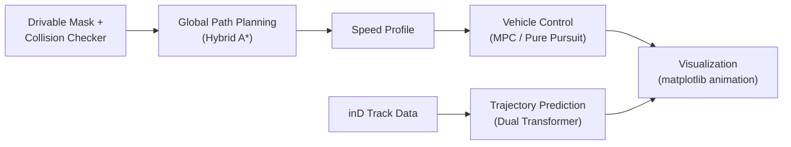

# Prediction-Planning-Control

A simulation pipeline for autonomous driving on the **inD dataset**, combining trajectory prediction, global path planning, and vehicle control into a single runnable demo with animated visualization.

## Pipeline



1. **Global path planning** — Hybrid A* generates a path from `EGO_START` to `EGO_GOAL`, validated against a drivable-area mask via `ImageMaskCollisionChecker`.
2. **Speed profile** — a target-speed profile is computed along the planned path.
3. **Control** — a `KinematicBicycle` model is driven by an MPC controller (Pure Pursuit is available as an alternative) to track the global path.
4. **Trajectory prediction** — a `Dual_transformer` model predicts the future trajectories of surrounding tracked vehicles from the inD dataset and compares them against ground truth (average deviation metric).
5. **Visualization** — all of the above (map, global path, ego trajectory, surrounding vehicles, predicted vs. ground-truth trajectories) is rendered frame-by-frame as a matplotlib animation.

> **Note on architecture:** trajectory prediction and ego vehicle control currently run **in parallel, independently** — the predicted trajectories are not yet fed into the control loop. There is no local/reactive planner yet; the ego vehicle simply tracks the pre-computed global path via MPC regardless of what's predicted for surrounding vehicles.

## Project Structure

```
prediction-planning-control/
├── trajectory_prediction/
│   ├── Data/                    # inD track CSVs, background images
│   ├── log/                     # training configs (json) and model weights (.pt)
│   ├── Models/
│   │   └── Dual_transformer.py  # trajectory prediction model
│   └── Utils/
│       ├── Average_deviation.py
│       ├── Base.py              # config loading, scale un-normalization
│       ├── Draw_trajectory.py
│       ├── Draw_vehicle.py
│       └── Make_tensor.py
├── planning/
│   └── global_path_planning/
│       ├── hybrid_a_star.py     # Hybrid A* global planner
│       └── collision_checker.py # mask-based collision checking
├── control/
│   ├── controllers/
│   │   ├── mpc.py               # Model Predictive Control
│   │   └── pure_pursuit.py      # Pure Pursuit controller
│   └── models/
│       └── kinematic_bicycle.py # vehicle kinematics model
├── map/
│   └── drivable_mask_images/    # drivable-area mask images
├── main.py                      # pipeline entry point
├── requirements.txt
└── .gitignore
```

## Installation

```bash
git clone https://github.com/jeongseonarm/prediction-planning-control.git
cd prediction-planning-control
pip install -r requirements.txt
```

Key dependencies: PyTorch 1.13.1 (CPU), NumPy, Pandas, OpenCV, matplotlib, tqdm.

## Usage

```bash
python main.py
```

The following data must be present (see path constants at the top of `main.py`):

| Path | Contents |
|---|---|
| `trajectory_prediction/Data/` | inD track CSV + scene background image |
| `map/drivable_mask_images/` | drivable-area mask image for the scene |
| `trajectory_prediction/log/` | prediction model config (`.json`) and trained weights (`.pt`) |

## Key Parameters (`main.py`)

| Parameter | Description |
|---|---|
| `DATA_NUM` | inD scene/recording number to load |
| `EGO_START`, `EGO_GOAL` | ego vehicle start/goal state `[x, y, theta]` |
| `TARGET_SPEED` | target cruising speed |
| `MPC_HORIZON` | MPC prediction horizon |
| `INPUT_FRAME`, `OUTPUT_FRAME` | input/output frame length for trajectory prediction |
| `PREDICTION_START_FRAME`, `PREDICTION_END_FRAME` | frame range simulated |

## Roadmap / Limitations

- [ ] **Local planner not yet implemented.** Prediction output is currently not used to influence control; a reactive/local planner that consumes predicted trajectories (e.g. for collision avoidance or replanning) is planned for a future update.
- [ ] Integrate prediction results into the control loop instead of running them in parallel.

## Notes

- Inference runs on CPU only (`torch==1.13.1+cpu`); no GPU required.
- Pretrained weights (`.pt`) and the inD dataset are not included in this repo and must be provided separately.

## License

TBD — no license has been chosen yet. Without one, default copyright rules apply (others cannot legally reuse/redistribute the code). Add a `LICENSE` file (e.g. MIT, Apache-2.0) once you decide.
