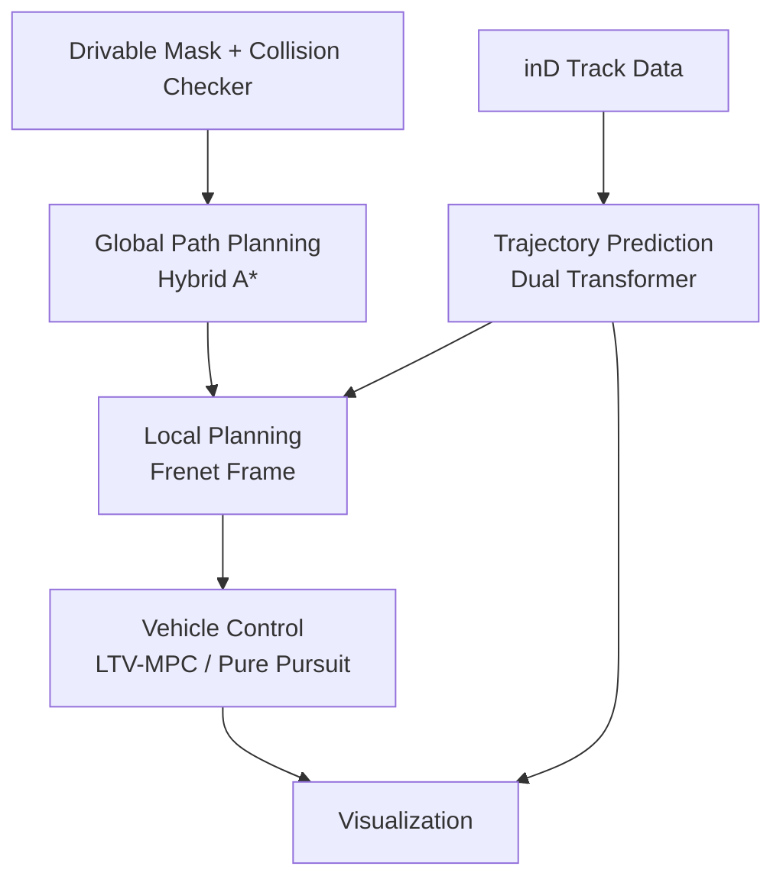

# Prediction-Planning-Control

Python implementation of an autonomous driving pipeline on the **inD dataset**, integrating trajectory prediction, global path planning, Frenet-frame local planning, and vehicle control into a single simulation with animated visualization.

## Overview

This project integrates the following components into an autonomous driving pipeline:

- **Trajectory Prediction:** Predicts future vehicle trajectories using a Dual Transformer model.
- **Global Path Planning:** Generates a global path using Hybrid A*.
- **Local Planning:** Generates a local trajectory in the Frenet frame, considering predicted vehicle trajectories and planning both the path and speed profile.
- **Vehicle Control:** Tracks the planned trajectory using Linear Time-Varying Model Predictive Control (LTV-MPC) or Pure Pursuit.
- **Visualization:** Displays the integrated pipeline and vehicle motion in an animated simulation.

## Pipeline



## Components

| Stage | Method |
|---|---|
| Trajectory Prediction | Dual Transformer |
| Global Path Planning | Hybrid A* |
| Local Planning | Frenet-frame trajectory generation with path and speed planning |
| Vehicle Control | LTV-MPC / Pure Pursuit |
| Vehicle Model | Kinematic Bicycle Model |
| Visualization | Matplotlib animation |

## Getting Started

### Requirements

- Python
- PyTorch 1.13.1 (CPU)
- NumPy
- Pandas
- OpenCV
- Matplotlib
- tqdm

### Installation

```bash
git clone https://github.com/jeongseonarm/prediction-planning-control.git
cd prediction-planning-control
pip install -r requirements.txt
```

## Data Preparation

Prepare the required datasets and model files before running the simulation.

| Directory | Description |
|---|---|
| `trajectory_prediction/Data/` | inD track data (CSV) and scene background images |
| `map/drivable_mask_images/` | Drivable-area mask images |
| `trajectory_prediction/log/` | Prediction model configuration (`.json`) and trained weights (`.pt`) |

**Note:** The inD dataset and trained model weights are not included in this repository and must be obtained separately.

## Run

Run the integrated simulation:

```bash
python main.py
```

### Key Parameters

The following parameters in `main.py` can be adjusted to configure the simulation:

| Parameter | Description |
|---|---|
| `DATA_NUM` | Selects the dataset or scene |
| `EGO_START` | Initial ego-vehicle position and heading |
| `EGO_GOAL` | Global planning goal |
| `TARGET_SPEED` | Target speed used by the planning and control setup |
| `MPC_HORIZON` | LTV-MPC prediction horizon |
| `INPUT_FRAME` | Number of observed frames for trajectory prediction |
| `OUTPUT_FRAME` | Number of future frames predicted by the model |
| `PREDICTION_START_FRAME` | Start frame for the prediction and simulation interval |
| `PREDICTION_END_FRAME` | End frame for the prediction and simulation interval |

## Project Structure

```text
prediction-planning-control/
├── trajectory_prediction/
│   ├── Data/
│   ├── log/
│   ├── Models/
│   │   └── Dual_transformer.py
│   └── Utils/
│       ├── Average_deviation.py
│       ├── Base.py
│       ├── Draw_trajectory.py
│       ├── Draw_vehicle.py
│       └── Make_tensor.py
├── planning/
│   ├── global_path_planning/
│   │   ├── hybrid_a_star.py
│   │   └── collision_checker.py
│   └── local_planning/
│       └── ...
├── control/
│   ├── controllers/
│   │   ├── ltv_mpc.py
│   │   └── pure_pursuit.py
│   └── models/
│       └── kinematic_bicycle.py
├── map/
│   └── drivable_mask_images/
├── main.py
├── requirements.txt
└── .gitignore
```

## Results

### Simulation

<!-- Add a simulation GIF or video here. -->

### Trajectory Prediction

<!-- Add quantitative evaluation results, such as ADE and FDE, here. -->

## License

No license has been specified yet.
