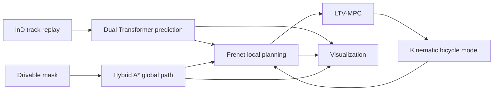

# Prediction, Planning, and Control

A Python simulation that combines surrounding-vehicle trajectory prediction, Hybrid A* global planning, Frenet local planning, and model-predictive control in a closed loop.

The default scenario uses the inD recording 18. It replays recorded traffic as a sensor feed and simulates the ego vehicle with a kinematic bicycle model.

## System overview



| Component | Implementation | Location |
|---|---|---|
| Global planning | Hybrid A* over a hand-drawn drivable-area mask | `planning/global_path_planning/` |
| Traffic prediction | Dual Transformer; 25 input frames and 75 predicted frames at 0.04 s spacing | `trajectory_prediction/` |
| Local planning | Frenet-frame trajectory candidates, map checks, and checks against predicted traffic | `planning/local_path_planning/` |
| Control | LTV-MPC by default; SLSQP NMPC is available as an alternative | `control/controllers/` |
| Runtime | Sequential loop or asynchronous multi-rate workers | `simulation/` |
| Animation | Matplotlib visualization and GIF writer | `simulation/visualization.py` |

The asynchronous runtime uses latest-value inputs, drops stale computations, and applies braking when control data is stale. It is a soft-real-time replay simulation, not a hard-real-time system or a vehicle interface.

## Setup

```bash
git clone https://github.com/jeongseonarm/prediction-planning-control.git
cd prediction-planning-control
python -m venv .venv
```

Activate the virtual environment, then install the dependencies:

```bash
python -m pip install --upgrade pip
python -m pip install -r requirements.txt
```

PyTorch can be installed as a CPU or CUDA build; follow the [official PyTorch install selector](https://pytorch.org/get-started/locally/) if the default package does not match your environment. CPU inference is supported.

## Local data and checkpoint

The inD data and trained checkpoint are not stored in this repository. The corresponding folders are present, their instructions are committed, and their contents are excluded by `.gitignore`.

1. Apply for and download the inD dataset from the [official inD page](https://levelxdata.com/ind-dataset/), following its terms.
2. For the default recording, place these files at the listed paths:

   ```text
   trajectory_prediction/data/18_tracks_del_vru_static_maneuver.csv
   trajectory_prediction/data/inD_backgroud_images/18_background.png
   ```

3. Put the trained PyTorch state-dict (`.pt`) that matches the model configuration in:

   ```text
   trajectory_prediction/checkpoints/
   ```

4. Keep the scene number consistent across the track CSV, background image, `map/drivable_mask_images/<number>_mask.png`, and `data_num` in `config.py`. This repository includes the hand-drawn mask for recording 18.

The inference architecture and normalization JSON files are in `trajectory_prediction/configs/`. The predictor loads the newest `.pt` file in `checkpoints/`. Raw dataset files, background image files, checkpoint weights, local training logs, and generated GIFs are not committed.

The inD terms restrict redistribution of the dataset and modified versions. They allow only qualifying abstract derivatives that do not contain or permit recovery of the dataset, for non-commercial use. Review the [official terms](https://levelxdata.com/ind-dataset/) before publishing model artifacts or results derived from inD.

## Run

Show the animation:

```bash
python main.py
```

Run headless, use the sequential runtime, or generate a GIF locally:

```bash
python main.py --no-viz
python main.py --execution-mode sequential --no-viz --start-frame 500 --end-frame 510
python main.py --save result.gif --fps 12
```

Useful options:

```text
--execution-mode multirate|sequential   Runtime scheduler (default: config setting)
--controller ltv|nmpc                   Controller (default: ltv)
--start-frame N --end-frame N            Dataset frame range; end frame is exclusive
--no-viz                                 Skip the animation window
--save PATH                              Save an animation (GIF or a Matplotlib-supported video format)
--fps N                                  Playback rate for the saved animation
--loop                                   Make a saved GIF repeat forever
```

## Qualitative results

No inD-derived image or animation is included. The local visualization uses the inD background and recorded traffic; keep generated GIFs local unless your use is permitted by the dataset terms. For a public demo, use an approved figure or a synthetic scene without inD imagery or trajectories.

## Configuration

Edit `ScenarioConfig` in `config.py` to change the scenario. The main settings include:

| Setting | Purpose |
|---|---|
| `data_num` | Recording number; matching track, background, and mask files are required |
| `ego_start`, `ego_goal` | Ego start and goal pose `(x, y, yaw)` in metres and radians |
| `astar_step_size`, `astar_xy_res`, `astar_yaw_res_deg` | Hybrid A* motion and state-grid resolutions |
| `target_speed_kmh`, `max_speed_kmh`, `lateral_offsets` | Local planner speed and lateral candidates |
| `controller`, `mpc_horizon`, `dt` | Controller choice, horizon, and controller period |
| `execution_mode`, `simulation_period` | Runtime scheduling and vehicle integration period |
| `prediction_period`, `planner_period` | Asynchronous prediction and local-planner periods |
| `start_frame`, `end_frame` | Replay frame interval; `end_frame` is exclusive |

## Project structure

```text
prediction-planning-control/
├── main.py
├── config.py
├── control/
│   ├── controllers/                 # LTV-MPC and SLSQP NMPC
│   └── models/                      # kinematic bicycle model
├── map/
│   ├── drivable_mask_images/        # hand-drawn mask; recording 18 included
│   └── extract_driving_area.py      # mask editor; needs local background image
├── planning/
│   ├── global_path_planning/        # Hybrid A* and mask collision checks
│   └── local_path_planning/         # Frenet reference, candidates, and checks
├── simulation/
│   ├── visualization_helpers/       # vehicle and trajectory drawing functions
│   ├── async_runner.py
│   ├── runner.py
│   ├── visualization.py
│   └── world.py
└── trajectory_prediction/
    ├── checkpoints/                 # local-only .pt weights
    ├── configs/                     # architecture and normalization JSON
    ├── data/                        # local-only inD files
    ├── models/                      # Dual Transformer and building blocks
    ├── preprocessing/               # scaling and tensor preparation
    └── predictor.py
```

## License and attribution

Project code is available under the MIT License in [`LICENSE`](LICENSE), subject to the third-party notices in [`NOTICE.md`](NOTICE.md). The inD dataset has separate access and usage terms; it is not included in this repository.

For work using inD, cite the dataset paper and link to the official dataset page:

> J. Bock et al., “The inD Dataset: A Drone Dataset of Naturalistic Road User Trajectories at German Intersections,” IEEE Intelligent Vehicles Symposium, 2020, pp. 1929–1934, [doi:10.1109/IV47402.2020.9304839](https://doi.org/10.1109/IV47402.2020.9304839).
